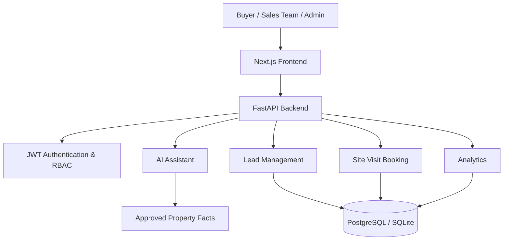

# EstateFlow AI

**An AI-powered real estate lead management platform and multilingual property concierge.**

EstateFlow AI helps residential property developers manage buyer enquiries, qualify leads, coordinate sales teams, and convert interested prospects into scheduled site visits.

## 🚀 Key Features

- **AI Property Assistant:** Multilingual support for English, Hindi, and Gujarati.
- **Lead Management:** Create, track, search, and manage buyer enquiries.
- **Lead Deduplication:** Detect duplicate leads using normalized phone numbers.
- **Sales Assignment:** Assign leads to sales executives and manage human handoffs.
- **Smart Site-Visit Booking:** Schedule property visits with capacity validation.
- **Analytics Dashboard:** Track lead conversion, response time, and acquisition sources.
- **Role-Based Access Control:** Separate permissions for Admin, Sales Head, Sales Executive, and Buyer.
- **Grounded AI Responses:** Answer property questions using approved property information rather than inventing details.

## 🛠️ Technology Stack

| Layer | Technologies |
|---|---|
| Frontend | Next.js 14, React 18, TypeScript |
| Styling | Tailwind CSS |
| Backend | Python, FastAPI |
| Database | PostgreSQL, SQLite |
| ORM | SQLAlchemy, Alembic |
| Validation | Pydantic |
| Authentication | JWT, bcrypt |
| AI Integration | OpenAI API |
| Testing | Pytest, HTTPX |
| Deployment | Docker, Docker Compose |

## 🏗️ Architecture



## 💡 Core Modules

### 1. AI Property Concierge
- Multilingual conversations.
- Buyer intent detection.
- Property information retrieval.
- Grounded responses using approved facts.
- Human escalation for unanswered questions.

### 2. Lead Management
- Lead creation and tracking.
- Phone number normalization.
- Duplicate lead detection.
- Acquisition source tracking.
- Lead qualification and status management.

### 3. Sales Management
- Role-based permissions.
- Lead assignment.
- Sales representative dashboard.
- Human handoff management.
- Site-visit attendance tracking.

### 4. Site-Visit Booking
- Available appointment slots.
- Slot capacity validation.
- Transactional booking operations.
- Duplicate booking prevention.
- Booking status management.

### 5. Analytics & Administration
- Lead conversion funnel.
- Response-time metrics.
- Source attribution.
- Property fact management.
- Visit-slot configuration.
- Administrative audit records.

## 👥 User Roles

| Role | Responsibilities |
|---|---|
| Admin | Manage users, property facts, and configurations |
| Sales Head | Manage leads, assign representatives, and view analytics |
| Sales Executive | Handle assigned leads and site visits |
| Buyer | Ask property questions and request site visits |

## 📁 Project Structure

```text
-ESTATEFLOW-AI/
├── backend/
│   ├── app/
│   │   ├── ai/
│   │   ├── api/
│   │   ├── core/
│   │   ├── models/
│   │   ├── schemas/
│   │   └── services/
│   ├── tests/
│   ├── Dockerfile
│   └── requirements.txt
├── frontend/
│   ├── src/
│   │   ├── app/
│   │   ├── components/
│   │   └── lib/
│   ├── Dockerfile
│   └── package.json
├── docs/
├── scripts/
├── .env.example
├── deployment.md
└── docker-compose.yml
```

## ⚙️ Getting Started

### Prerequisites

- Python 3.11+
- Node.js 18+
- npm
- Git
- PostgreSQL (optional for SQLite local setup)
- Docker (optional)

### 1. Clone Repository

```bash
git clone https://github.com/kri275shna/-ESTATEFLOW-AI.git
cd -ESTATEFLOW-AI
```

### 2. Backend Setup

```bash
cd backend

python -m venv venv
```

Activate virtual environment:

**Windows:**
```bash
venv\Scripts\activate
```

**Linux/macOS:**
```bash
source venv/bin/activate
```

Install dependencies:

```bash
pip install -r requirements.txt
```

Configure your backend environment variables in `backend/.env`.

Seed sample data if required:

```bash
python app/core/seed.py
```

Start backend:

```bash
uvicorn app.main:app --reload --host 0.0.0.0 --port 8000
```

### 3. Frontend Setup

Open another terminal:

```bash
cd frontend
npm install
```

Create `.env.local`:

```env
NEXT_PUBLIC_API_URL=http://localhost:8000/api/v1
```

Start frontend:

```bash
npm run dev
```

## 🔐 Environment Variables

Backend `.env`:

```env
PROJECT_NAME=EstateFlow AI
ENVIRONMENT=development
DATABASE_URL=sqlite:///./estateflow.db
SECRET_KEY=your-secret-key
ALGORITHM=HS256
ACCESS_TOKEN_EXPIRE_MINUTES=1440
CORS_ORIGINS=http://localhost:3000

OPENAI_API_KEY=
OPENAI_MODEL=gpt-4o-mini
```

Frontend `.env.local`:

```env
NEXT_PUBLIC_API_URL=http://localhost:8000/api/v1
```

Never commit actual API keys or production credentials.

## 🐳 Docker Deployment

From the project root:

```bash
docker-compose up --build -d
```

Check containers:

```bash
docker-compose ps
```

Stop containers:

```bash
docker-compose down
```

## 📚 API Documentation

Once the backend is running:

- Backend: http://localhost:8000
- Swagger UI: http://localhost:8000/docs
- Health Check: http://localhost:8000/api/v1/health

## 🧪 Testing

Run backend tests:

```bash
cd backend
python -m pytest tests/ -v
```

The deployment documentation reports 37 passing tests. Run the test suite against your current checkout to verify.

## 🔒 Security

- JWT-based authentication.
- Password hashing with bcrypt.
- Role-based authorization.
- Backend validation using Pydantic.
- Environment-based secrets.
- Transactional booking operations.
- Restricted CORS configuration.

## 🚀 Future Enhancements

- WhatsApp Business API integration.
- Automated SMS and WhatsApp reminders.
- Advanced semantic property search.
- Google Calendar integration.
- Production monitoring and logging.
- CI/CD automation.
- Advanced AI-based lead scoring.

## 📖 Documentation

- [Technical Design Document](docs/TDD.md)
- [Deployment Guide](deployment.md)

## 📄 License

No license is currently specified. Add a license file if you intend to permit public reuse.

---

**Developed by [Krishna Mehra](https://github.com/kri275shna)**

[GitHub Repository](https://github.com/kri275shna/-ESTATEFLOW-AI)
